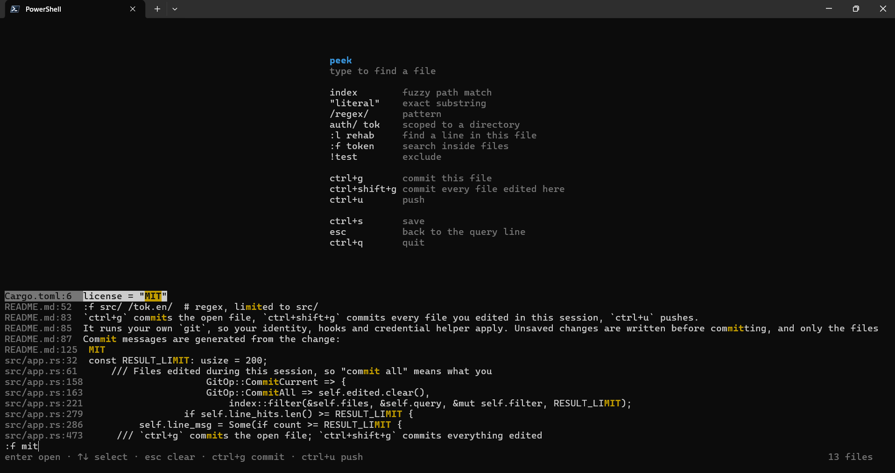
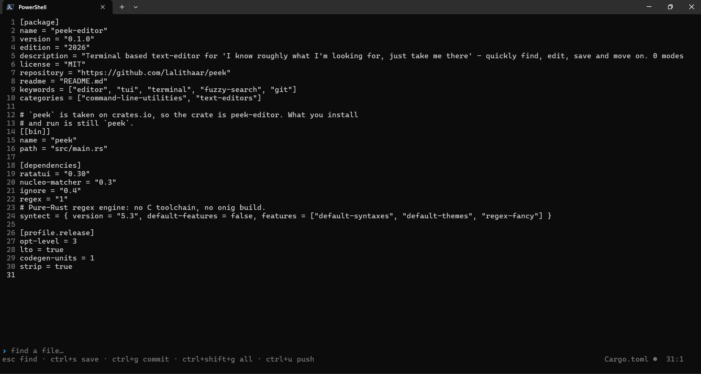

Terminal based text-editor for "I know roughly what I'm looking for, just take me there" - quickly find, edit, save and move on.




You can install with
```bash cargo install peek-editor```

Crates: https://crates.io/crates/peek-editor\
Github: https://github.com/lalithaar/peek

A text editor based on rust yeah, you can just search for file name with no flag, add :f searchterm for within files, and :l for search within currently open file, it has git integration so you just do `ctrl+g` for add+cmt current file, `ctrl+shift+g` for all edited files in this particular peek window alone, and `ctrl+u for push`.

I was annoyed by having to use file pickers just to find a file where I remember using the word 'court', so.
