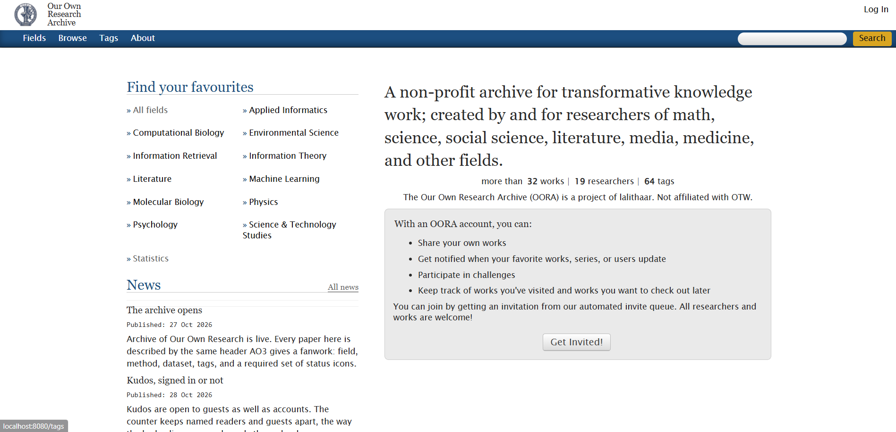
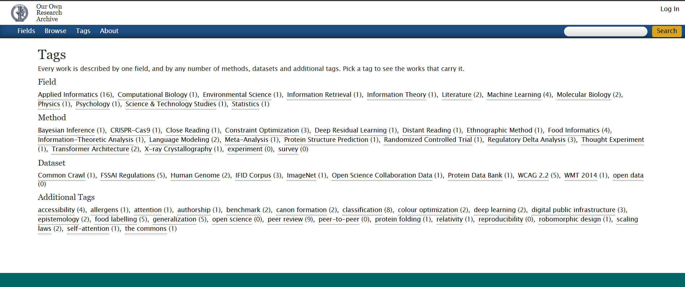
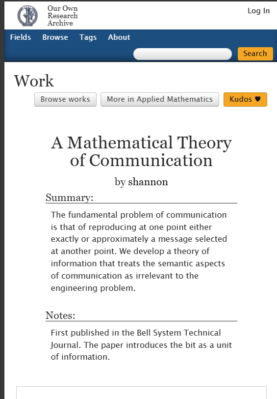
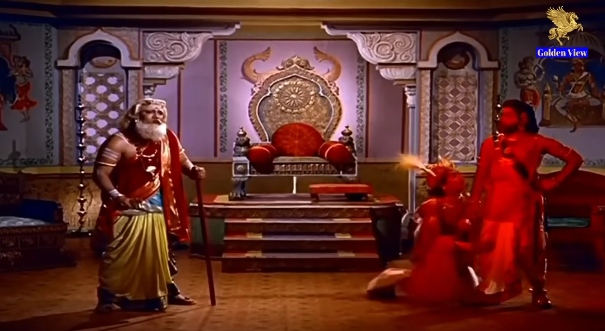

# Our Own Research Archive - Open, free and accessible science

*500 foundational works across subjects released as responsive HTML, an open source golang framework that just works, and infra that maintains itself further*

  

    

      ₹0
      / ₹5,00,000 backed
    

    Base Gate: Stipend (₹0 / ₹2.5L)
  

  

    

      Stipend
      ₹2.5L
      

    

    

      Infra
      ₹3L
      

    

    

      APIs
      ₹4L
      

    

    

      

        

      

      

        

      

      

        

      

      

        

      

    

    

      ₹0
      ₹5,00,000 Goal
    

  

  

    

      
        
        1. Stipend
      
      
        ₹0 / ₹2.5L
        Base Gate
      
    

    

      
        
        2. Server &amp; Tooling
      
      
        ₹0 / ₹50k
        Open
      
    

    

      
        
        3. API Credits
      
      
        ₹0 / ₹1L
        Open
      
    

    

      
        
        4. Hardware
      
      
        ₹0 / ₹1L
        Open
      
    

  

## Project summary

In 3rd century BCE, there goes the legend of a scholar who stared in the eyes of the lord to say "A flaw is a flaw, even if you open your third eye," calling out a factual error even if you are the god. While the king stands perplexed between bowing to the lord, but not daring the scholar to calm down.

The scholars were never the ones to bow down to anything. Journals were meant as a curated collections with the particular vision, for easier reading and follow through.

But today:
- Public tax and grants fund the research work
- Researchers do research on their subject and create breakthroughs
- Researchers then spend months in the submission cycle for every single journal they want to attempt to, because you cannot publish one paper to be included in two journals (Imagine if someone said one song can only be in person's playlist and no other?)
- Other researchers spend their time reviewing the draft for free
- They tell you, your work is accepted to their journal
- So after doing the work, you also pay in thousands of dollars to sign over your copyright, you bundle it into 2 column 8pt layout that got it's culture from 17th century when you had to save space, except it's digital now and still hasn't changed after centuries. 
- Your institution either pays millions of dollars to read and access the work they funded.
- Oh you want it without a subscription? Pay $48 for 24 hours access to this specific article. For the work your fellow colleague did.

and that's assuming your paper fits that specific human committee's vision of what the field should read. 

If your paper is slightly outside of any of the conditions laid out even if it's world changing? Nope for journals. If it's Math/CS/.., you could probably try Arxiv. But any moment it fails to be captured in just 2-3 fields because it applies methods used in one field, theory of another, and experimenting routines of 3rd (even if it's how the best discoveries and inventions are made) ? Nope.

That's what academic journal wheel tells everyone. 

What do you do? Dump it as a pdf in a format that's expected into any of the servers that serve PDF, and let's not even start about their discoverability.

Back in mid to late 2000's, fan made stories also called fanfictions, were forming a community. You write and submit it to fanfiction.net or similar app, guess what they did? deleted thousands of works overnight without notice of what they considered as bad or good, deleted any works that could offend the advertisers, and thousands of fans lost hundreds of thousands of words of writing. It's either their curated collection, which holds every right over your life's work and can delete them at whim

...sounds eerily familiar? Yup, same problem as current research distribution.

Guess what they did? Fans came together to create "Archive of our own" (AO3) - a non profit, non commercial archive by and for fans to host their works without the overlords, with one goal:

Make a work findable to someone to who wants it by...letting them search for it. Yes, not a fancy algorithm, but literally lets you do

**Fandom: Harry potter, Lord of rings**\
**Include: Time travel, Chamber of Secrets**\
**Exclude: Mature Scenes**

Oh yes,

**Field: Biotechnology, Biology**\
**Include: Protein Folds, Negative Results**\
**Exclude: Survey Papers**

See? It's been 17 years that day, and now has hosted over 18.4 million works. You get it. (If you don't it's okay, please feel free to drop your doubts in comments and I will be happy to explain : )

## What are this project's goals? How will you achieve them?

The codebase of AO3 is open source. But it was built in 2008-09 when Ruby on Rails were the gold standard for web frameworks, and we have come a long way since then.

Adopting a system is taking the best parts of it (architecture) and leaving the baggage that comes with that history (Ruby, Elastic search is an absolute hoarder), and implementing it through what's gold standard today.

Everything in rust would give the best performance, but not so much in long term maintenance. So, we are going with golang - accessible enough language for the community to learn but performant enough for sustainability.   

There comes our goals in the long term:
- Full feature parity (as appropriate, leaving out fandom specific quirks) golang port becomes OORA - Our Own Research Archive
- A server side rendering golang framework strong enough to hold the logic of AO3, also open sourced for the wider community, so it's useful beyond this immediate project. (See cozy-mug for current progress) to support projects built in resource constrained environments, so you don't have to choose between performance, accessibility, and minimal resource usage.
- Allow researchers; to post their works freely, write in markdown, HTML first with PDF Download support, built in search engine optimization, along with choice to consent to AI reading it vs training in it.
- Release foundational works across the fields in the same format to make science accessible, even if retrospectively. Further funds will help increase the coverage of these works in CC by or public domains.
- Give back journal curation to scholars. Anyone with their team can form a thesis to create a journal on, and community kudos support it.
- Researchers wake up to kudos and bookmarks of their works, rather than just 1-2 citations now and then.
You may ask, but Lalitha how are you even going to scrape and format all those papers? I plan to expand upon the CAAS framework (Constrained AI-Assisted Sampling for Fragmented Textual Spaces: https://isrl-research.github.io/pub/2026-04-m-caas/) I used to tackle the last project (also converged with Google Research independently on global flood data.)  for agentic workflows, 

But grounding it through taxonomy, and guidelines that's not just mark down files, so it doesn't go into existential crisis over a single confusion that could have been resolved with a single yes or no from the user, thereby wasting tons of tokens.

  

    <h3 class="fw-follow-title">Follow the build by email</h3>
    
Occasional updates when milestones ship — no spam.

  

  <form class="fw-follow-form" id="fw-follow-form">
    <label for="fw-follow-email" style="position:absolute;width:1px;height:1px;overflow:hidden;clip:rect(0,0,0,0);">Email address</label>
    <input class="fw-follow-input" id="fw-follow-email" type="email" name="email" placeholder="you@domain.com" required autocomplete="email" />
    <button class="fw-follow-btn" id="fw-follow-btn" type="submit">Follow Updates</button>
  </form>
  

## How will you know it worked?

- Golang framework developed enough for alpha
- 500 foundational papers in accessible HTML, indexed in google.

**Here's the deal**, I know it is only the best case that everyone finds their place and it becomes the new standard, I know the probability is low.

**But here's the worst case:** 500+ foundational works across subject matters turned into fully accessible responsive html that can be indexed in google, and filtered by exactly what you want to look for. An SSR framework in golang that is strong enough to host the scale - open sourced so people working in resource constrained environments can whip up a project 0-1 without sacrificing the performance go language offers. A free space for people to host their works, and each funding bringing down the costs needed to add further papers compounding down.

## How will this funding be used?

Total to get it running: ₹5,00,000 (~$5,400) (brought down from ~$8,500 as shown in manifund)

**Capex:**
- ₹1,00,000 for hardware (Marker PDF, core library needed for this work needs better hardware) 
- ₹50,000 (~$500) for server (Looking into Hetzner CAX21), image processing, backups and deployment.

**Opex:** ₹1,00,000 for AI credits across parsing, typesetting, taxonomy work, etc.

**Stipend & Tax Buffer:** ₹2,50,000 (~\$2,900) for working on processing, overseeing, engineering, along with taxonomy classification and design. I previously listed this as \$6,000, but I do not wish for this to be a blocker to this work as it stemmed from something I believe in.

I also accounted for the 10% TDS buffer and kept hard expenses at or below 48% for Section 44ADA so the project doesn’t become unsustainable from running short on cash or paying out of pocket.

**This will enable:**

- Release 500 foundational works across subjects in responsive HTML in the web instead of it being stuck in PDF's.
- Give researchers a place to publish their works with proper in site search, along with SEO built in. They don't have to worry about formatting and can write in markdown. Control over whether it can be cited by AI, and also if it can be used for training purposes (through `robots.txt` support per work).
- Running server for 2 years to ensure the work remains active. 
- Covers core Capital expenditures, so every further fund focuses on Operational expenditures and releasing more and more papers.
- Alpha Release of SSR Golang framework that just works.

**Past the initial 5 lakhs, every ₹ from here on:** split between stipend and AI credits.

**This will enable:**
- Support further development of the go lang framework
- Maintenance and support for OORA application
- Research, catalogue and discover more works with open licenses
- Produce OORA versions of the works
- Support proper tagging, and tag wrangling of the new works added.
- Estimated 300 works per month.
- Further development of the architecture/pipeline used in this process to reduce costs per paper the more papers we add.

## How can I support this?

Right now, direct financial backing and introductions to people who back independent open work are what move the needle most. If you're not in a position to back it financially, sharing the page with someone who might be is just as useful. Email replies typically take a few hours during this build phase, and the progress bar updates within 24 hours of any transfer.

  

    UPI · India
    <h3 class="fw-card-title">Back OORA via UPI</h3>
    
Zero platform fees — everything goes straight into the work.

    
    

      

        
UPI ID

        
isrl-res@ptyes

      

    

  

    NEFT / IMPS · India
    <h3 class="fw-card-title">Direct Bank Transfer</h3>
    
Prefer regular bank transfer or coordinating a larger bucket transfer / TDS note? Drop a quick email and I'll reply with the account details.

    

      <a class="fw-card-btn" href="mailto:lalithaar.research@gmail.com?subject=Bank%20details%20for%20OORA">Request Bank Details →</a>
    

  

  

    GitHub Sponsors
    <h3 class="fw-card-title">Sponsor on GitHub</h3>
    
For backers outside India or teams already set up on GitHub billing.

    

      <a class="fw-card-btn" href="https://github.com/sponsors/YOUR-HANDLE" target="_blank" rel="noopener noreferrer">Open GitHub Sponsors →</a>
    

  

## Who is on your team? What's your track record on similar projects?

I will be working on this solo, while consulting Subject Matter Experts for any doubts that may arise during tag creations in the respective fields. 

In the last year, I led an [open research lab](https://isrl.in/pausing-isrl-respecting-the-work-supporters-and-oneself/). It started with a computer saying instant noodles is healthier than rice and as an advocate for non violence, I didn't want it to be beaten by every grandma in the area. So I went down a 9 month rabbit hole that produced 9 works, all open source with 3,813 reads, 1,780 downloads,

It was process open, not just outputs. 

Developed the E-M-F Tri-Axial Model for ingredient identity, transformation, and function: a method informed by S. R. Ranganathan's Colon Classification, a century of Supreme Court precedents, ITC-HSN codes, and FSSAI rulesets.

It is the first method to apply NOVA processing deterministically at the ingredient level, trained undergraduate researchers to move from basic research practice to multi-jurisdiction legal analysis in four weeks.

We produced an [allergen](https://github.com/orgs/isrl-research/discussions/4) report that compared the regulations regarding food allergens across 5 jurisdictions along with reconciling it with what the medical literature said.

It was reviewed by an expert who spent his career on studying food allergens in India, and his comment was “It has come out well. Very few comments”.

We planned to submit the work to a journal but also push it to a preprint server. Then came the task that was tougher than producing the work itself: finding a journal.

No, this didn't have a generalised global report because the problem at hand was for India. Submitting it to a global journal meant toning down everything that was India specific about it, that is trying to pose infant food as adult food and vice versa.

We tried Indian journals, but all of them meant we must not push it to an open server or internet at any level and must be in their format however inaccessible.

I paused the project few months later to protect the integrity of the work, because despite all the work, the first doubt wasn’t about a methodology we used, or how it can be generalized, but rather that of the legitimacy of the work and which huge institution is doing the work to deserve/receive support and funding.

The second doubt was, why is it not published in an international Q1 journal (Even if that would mean watering down the reports to fit the journal’s vision and to generalize it so it’s not ‘only for India’ but widely applicable. In a work, that is specifically for India.)

That was an open question I had in mind since then, where is the space for works that don't fit the specific academic silo a particular journal expects? That publishing a non silo'd work in the open without paying $8000 shouldn't mean the work being inaccessible, un-indexed, skepticism at every stance instead of rational judgement of the work.

Few months later is when I got a direction on how we can tackle this, cue OORA.

## What are the most likely causes and outcomes if this project fails?

- Agentic workflows not being strong enough to cleanly port the papers, but we still have the fallback of existing agentic system even if the experiment to bring down the costs fail
- Feature bloat. I plan to tackle this by only adding the core features needed for it to be functional, and nothing more. AO3's codebase will also help me anchor this in the heuristic.

## How much money have you raised in the last 12 months, and from where?

It was a microgrant of ₹50K to cover a component of the work done by the open lab I said about, from FOSS United Foundation through Nagarathna Memorial Grant.

## FAQ

1. **What do you mean by ₹2.5L being a gate?**\
   The compute and hardware will not be useful immediately unless I have the capacity locked in to work on this in time and effort.
2. **Why this project?**\
   I am familiar with underlying components of this seperately: data aggregation and classification using AI, how research publishing happens, golang and it's library ecosystem, and python. So that makes it clean enough to execute, but still challenging enough for it to be fascinating.
3. **Why not instituional grants that pay far more?**\
   Because I want this to be deployed in near-future, and not a decade later after all the committe discussions and bureaucracy trap.